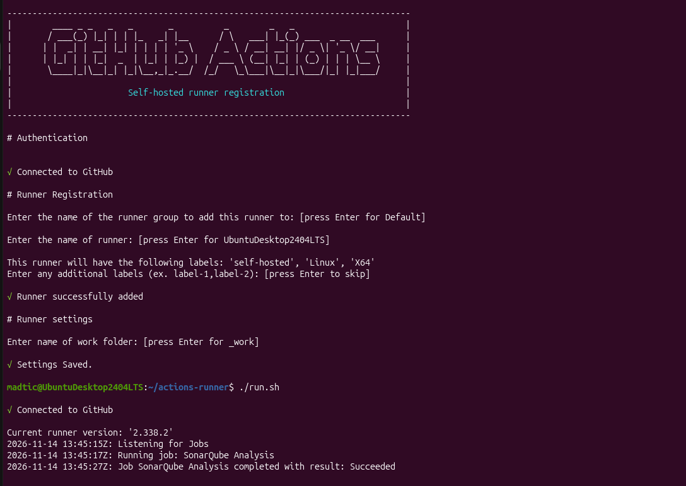
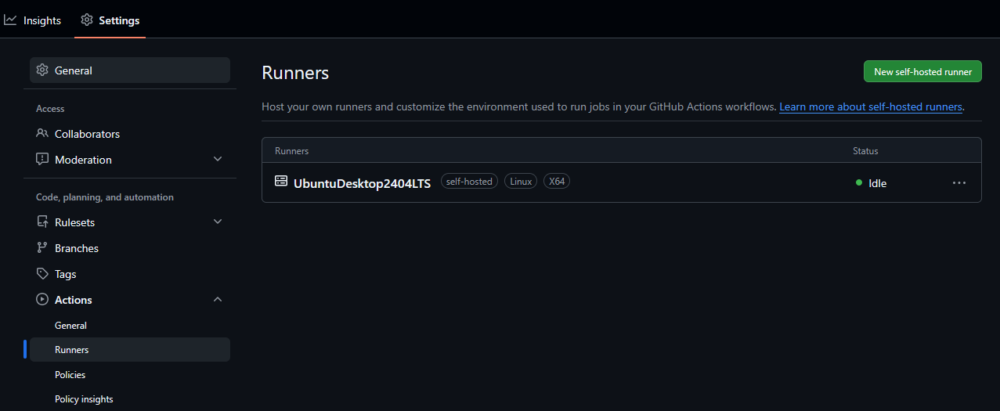
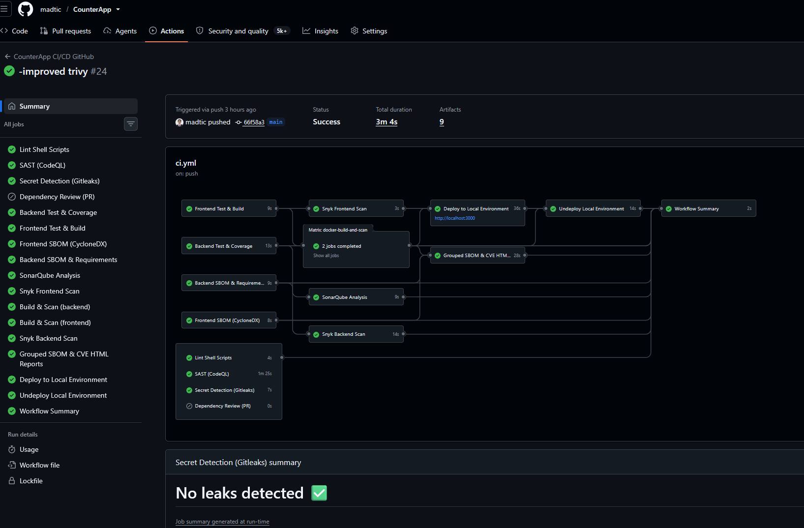
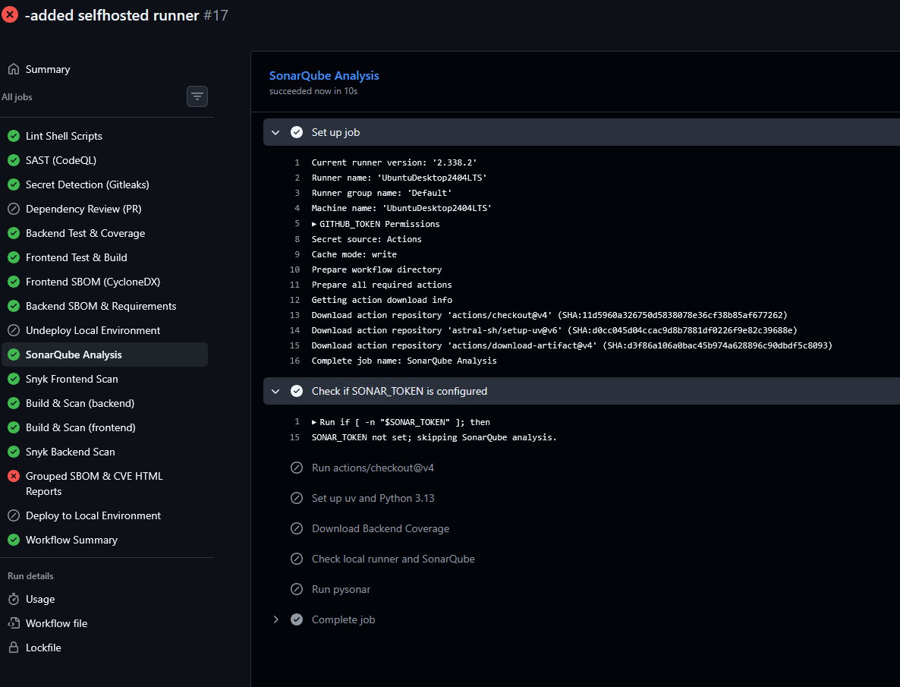
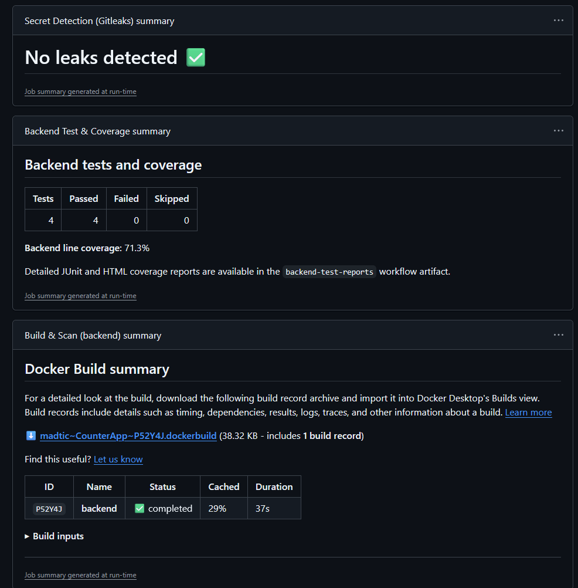

# GitHub Actions CI/CD und Self-Hosted-Runner

**Projekt:** CounterApp

**Öffentliches Repository:** [github.com/madtic/CounterApp](https://github.com/madtic/CounterApp)

**Workflow-Datei:** `.github/workflows/ci.yml`

**GitHub-Dokumentation:** [Self-Hosted-Runner verwalten](https://docs.github.com/en/actions/how-tos/manage-runners/self-hosted-runners)

## Projekt und Pipeline

Der Workflow startet bei Pushes auf Branches und Tags sowie bei Pull Requests. Er führt Shell-Linting, CodeQL-Analysen, Geheimniserkennung, Backend-Tests mit Coverage und einen Frontend-Build aus. Er erstellt SBOMs per Komponente, baut und scannt Backend- und Frontend-Container-Images mit Trivy und veröffentlicht die Images in der GitHub Container Registry (GHCR). Testergebnisse und Schwachstellenübersichten werden in der Zusammenfassung des Actions-Laufs angezeigt und als Workflow-Artefakte bereitgestellt.

Nach erfolgreichem Image-Build und Scan bei einem Push verwendet der Workflow einen **Self-Hosted-Runner mit Linux x64** (lokale Ubuntu VM), um die Images bereitzustellen, die Backend- und Frontend-Endpunkte zu prüfen und die Anwendung anschließend wieder zu entfernen. So wird die lokale Docker-Umgebung bei jeder Branch-Änderung getestet. Ein manueller Lauf auf dem Standard-Branch kann ebenfalls mit `deploy` oder `undeploy` gestartet werden.

## Einrichtung und Ausführung

1. Die Linux VM als repositorygebundenen Self-Hosted-Runner einrichten. Docker und Docker Compose müssen verfügbar sein. Der Runner muss unter **Settings → Actions → Runners** als online angezeigt werden.
2. Die Runner-Labels müssen zum Workflow passen: `self-hosted`, `linux` und `x64`. Die Deploy- und Undeploy-Jobs verwenden außerdem die GitHub-Umgebung `local`.
3. Eine Änderung auf einen Branch pushen. Die GitHub-gehosteten Jobs führen Tests, Build und Scan aus. Nach deren Erfolg stellt der lokale Runner die Anwendung bereit, führt HTTP-Smoke-Tests aus und entfernt Container und Volumes.
4. Unter **Actions → CounterApp CI/CD GitHub** den abgeschlossenen Lauf und dessen Deploy-/Undeploy-Jobs prüfen.

Die optionalen SonarQube- und Snyk-Prüfungen benötigen `SONAR_TOKEN` und `SNYK_TOKEN` als Secrets der Umgebung `quality`. `SONAR_HOST_URL` und `SONAR_ORGANIZATION` sind optionale Umgebungsvariablen. Wenn die benötigten Tokens fehlen, werden diese Integrationen absichtlich übersprungen; der Build und der lokale Deployment-Test können trotzdem erfolgreich sein.

## Github Actions

Im öffentlichen Repository ist unter Action die CI / CD Jobs zu finden:

- [Lauf #24 — erfolgreicher CI/CD-Lauf](https://github.com/madtic/CounterApp/actions/runs/43608959588) (Branch `main`, Commit `66f58a3`, 14. November 2026).
- Der [Job „Deploy to Local Environment“](https://github.com/madtic/CounterApp/actions/runs/43608959588/job/132490112496) lief erfolgreich auf dem Runner **UbuntuDesktop2404LTS** (`self-hosted`, `linux`, `x64`). Deployment sowie Backend- und Frontend-Smoke-Tests waren erfolgreich.
- Der [Job „Undeploy Local Environment“](https://github.com/madtic/CounterApp/actions/runs/43608959588/job/132490297924) wurde auf demselben Runner erfolgreich abgeschlossen.

## Herausforderungen und Lösungen
- **Benutzen von Github Komponenten codeql und secret scan**: umbau von Gitlab zu Github nutzung von Github Architektur statt pipeline in Gitlab zu Github [Action](https://docs.github.com/de/actions/reference/workflows-and-actions/workflow-syntax) und CodeQL für Analyse des Code sowie Trivy-Ergebnisse werden als [SARIF](https://docs.github.com/en/code-security/how-tos/find-and-fix-code-vulnerabilities/integrate-with-existing-tools/upload-sarif-file) hochgeladen
- **Erstellung von Trivy-Berichten:** Der erste Schritt zur Erstellung des HTML-Berichts schlug fehl, weil verschachtelte Shell-Anführungszeichen zu Problemen führten. Der Ablauf wurde so geändert, dass Trivy mit expliziten Docker-Volume-Einbindungen und klaren Befehlen gestartet wird.
- **Wiederholte Schwachstellenscans:** Zunächst wurden Container-Images getrennt für SBOM gescannt und danach erneut für den CVE Berichte. Der aktuelle Workflow scannt jedes Image einmal und erzeugt eine JSON-Datei, dieses Ergebnis wird anschließend in CycloneDX format zum HTML-Berichte erstellen mit `trivy convert` benutzt.

## Screenshot

### Lokalen Runner **UbuntuDesktop2404LTS** Sonarqube Job
 

### Lokalen Runner in Github UI
 

### Github CI CD Action
 

###  Github Ci CD Job auf selfhosted lokalen Runner
 

###  Github UI Infos nach erfolgreichen Job

